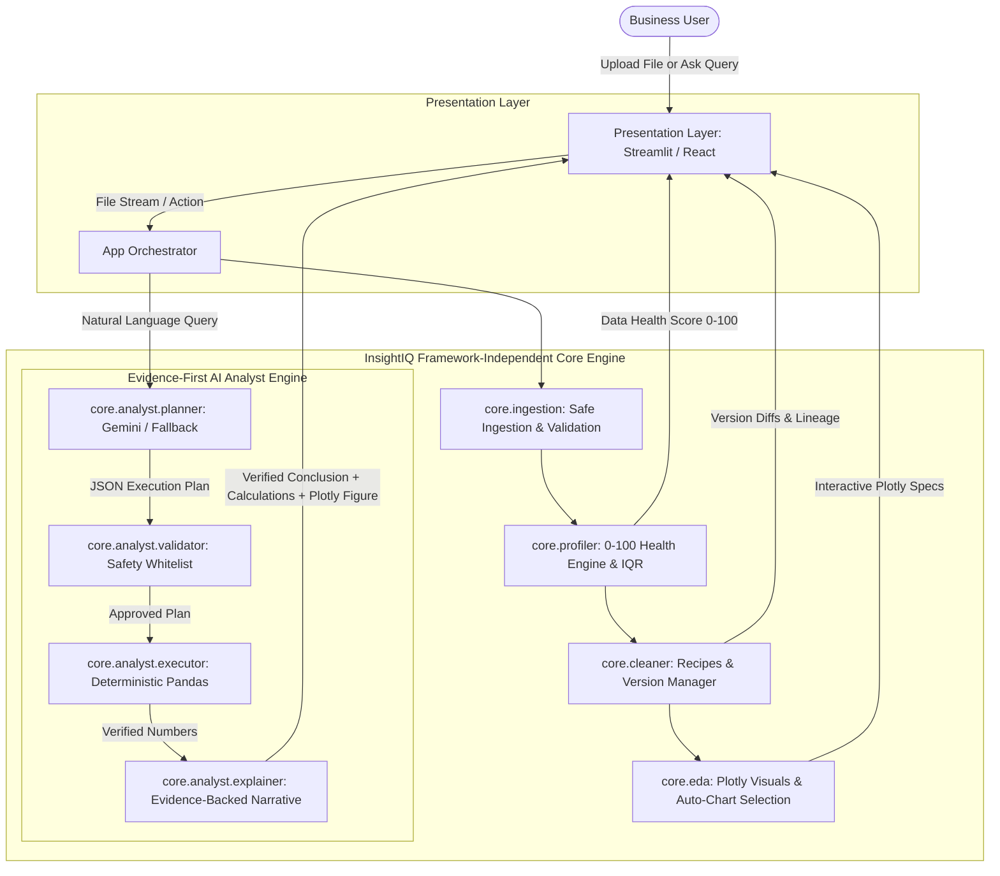
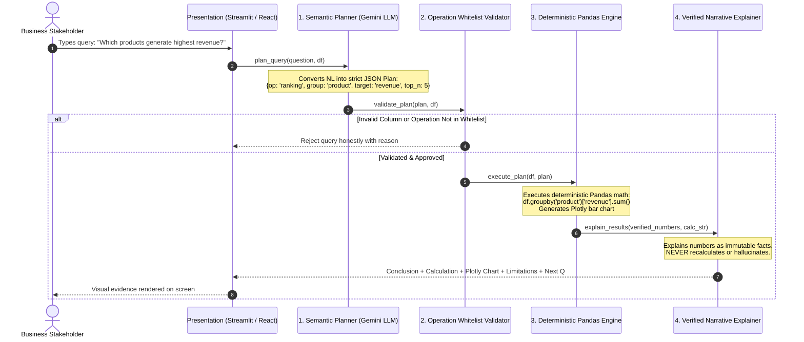
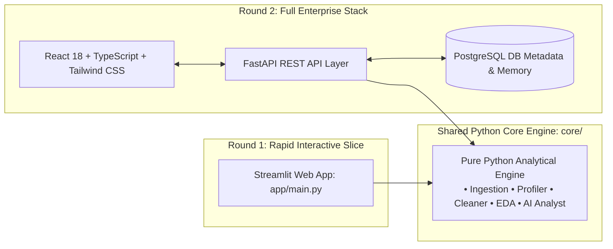

# 🏛️ InsightIQ System Architecture Blueprint

InsightIQ is designed around a **strictly decoupled, modular architecture**. The business analytical logic, statistical algorithms, and AI query-planning engine are completely isolated from the presentation layer.

---

## 1. High-Level System Architecture

---

## 2. Evidence-First AI Analyst Sequence Flow

---

## 3. Data Health Scoring Mathematical Model

The Data Health Engine calculates an interpretable score $S \in [0, 100]$ across 4 quality dimensions:

$$S = 0.30 \cdot S_{\text{completeness}} + 0.25 \cdot S_{\text{uniqueness}} + 0.25 \cdot S_{\text{validity}} + 0.20 \cdot S_{\text{uniformity}}$$

### Dimension Formulations:
1. **Completeness ($30\%$ weight):**
   $$S_{\text{completeness}} = \max\left(0, 100 \times \left(1 - \frac{\text{Missing Cells}}{\text{Total Cells}}\right)\right)$$
2. **Uniqueness ($25\%$ weight):**
   $$S_{\text{uniqueness}} = \max\left(0, 100 \times \left(1 - \frac{\text{Duplicate Rows}}{\text{Total Rows}}\right)\right)$$
3. **Validity ($25\%$ weight):**
   $$S_{\text{validity}} = \max\left(0, 100 \times \left(1 - \frac{\text{Unparseable Dates + Negative Prices + Bad Tokens}}{\text{Total Rows}}\right)\right)$$
4. **Statistical Uniformity ($20\%$ weight):**
   Evaluated using the non-parametric Interquartile Range ($IQR = Q_3 - Q_1$). Outlier bounds are defined as:
   $$\text{Lower Bound} = Q_1 - 1.5 \times IQR, \quad \text{Upper Bound} = Q_3 + 1.5 \times IQR$$
   Penalizes excess outliers ($> 2\%$) that distort business metrics.

---

## 4. Architectural Decoupling: Round 1 vs. Final Round

### Architectural Guarantee for Evaluators:
- All data logic in `core/` has **zero dependencies** on Streamlit.
- In Round 2, adding the FastAPI layer and React frontend requires **zero changes** to any profiling, cleaning, EDA, or AI Analyst algorithms in `core/`.
