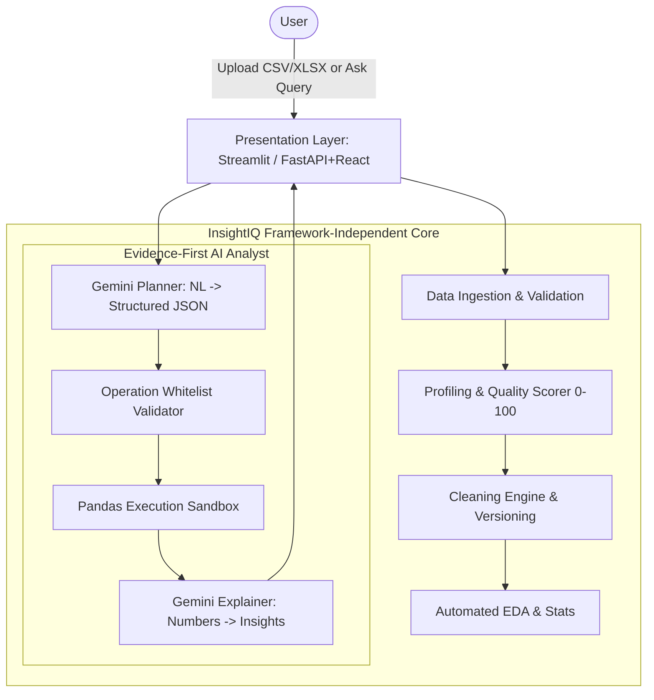

# InsightIQ Architecture Blueprint

## System Overview

InsightIQ is designed with a **decoupled, modular architecture**. The analytical and AI intelligence core is kept completely isolated from the presentation layer.

## Layer Separation Principles

1. **`core/` (Zero UI Dependencies)**:
   - Does not import `streamlit`, `fastapi`, or any web framework.
   - Accepts standard Python types, DataFrames, dictionaries, and returns pure structured data / results.
   - Allows seamless migration to FastAPI + React in the final round without touching analytical logic.

2. **`app/` (Presentation & Orchestration)**:
   - Manages user sessions, widgets, file uploading, and rendering Plotly charts.
   - Calls `core/` functions for all computations.

3. **Evidence-First Security Rule**:
   - The LLM **never** generates executable arbitrary Python code.
   - The LLM outputs a constrained JSON execution plan (`operation`, `columns`, `filters`).
   - The backend validates the plan against a strict schema whitelist before invoking deterministic Pandas operations.
